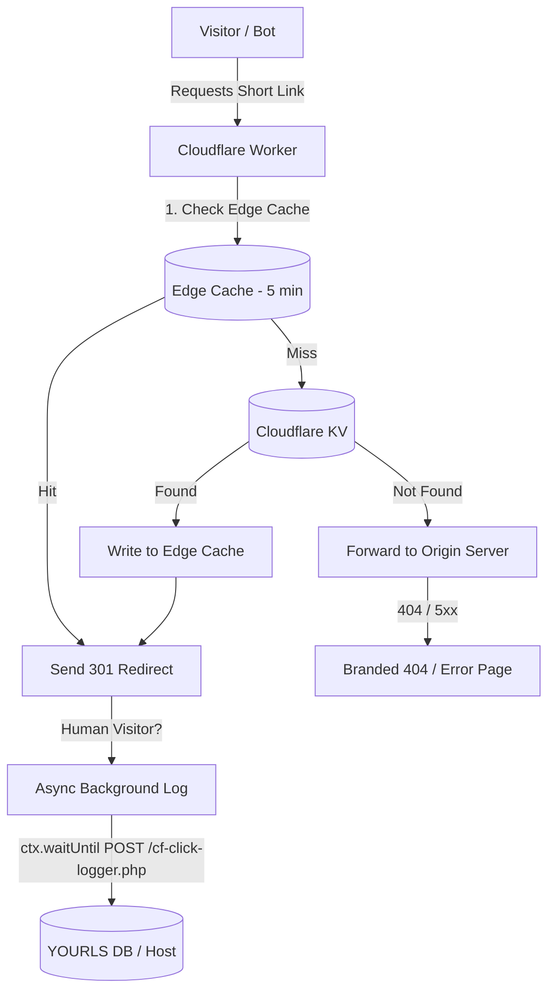

# Edge Redirects for YOURLS — Cloudflare KV & Worker

High-performance, ultra-low-latency edge redirection and analytics synchronization system for [YOURLS](https://yourls.org/) powered by Cloudflare Workers and Workers KV.

---

## ✨ What's New (v1.2)

- **⚡ Cloudflare Edge Cache API Layer:** Added a 5-minute memory cache (`caches.default`) on top of KV to dramatically cut down KV read operations and lower response latency.
- **🛡️ Negative 404 Caching:** Missing keywords and bot probes are cached for 5 minutes at the edge to prevent scrapers and scanners from draining KV read quotas.
- **🔄 Keyword Renaming Sync:** When editing links in YOURLS, changing a keyword now automatically removes the old keyword from KV and registers the new one.
- **🏷️ UTM & Query String Passthrough:** Forwards all query parameters (e.g. `utm_*`, `ref`) to the destination URL while filtering internal Cloudflare challenge tokens (`__cf_chl_*`).
- **💬 Social Link Preview Compatibility:** Intelligent fallback responses (HTTP 200) for WhatsApp, Telegram, Discord, Facebook, Twitter, and LinkedIn crawlers so OpenGraph meta previews render cleanly.
- **🤖 Enhanced Bot & Scanner Filtering:** Denylists monitoring services, automated security scanners, and advertising bots from inflating click analytics.
- **🔁 Loopback Safeguards & Error Logging:** Added `X-From-Logger` header protection against subrequest loops, extended cURL timeouts, and detailed error logging in the YOURLS plugin.

---

## ⚡ Why This Exists

1. **Eliminate Server & Database Load:** Normal short-link redirects require executing PHP and querying MySQL on your origin server for every single visitor. With this integration, redirects are resolved directly on Cloudflare's global edge network in single-digit milliseconds without touching your server.
2. **Preserve Accurate Analytics:** Clicks and visitor metadata (IP, referrer, user agent, country code) are logged asynchronously to your YOURLS database in the background without blocking the visitor's redirect.
3. **Edge Caching & KV Read Optimization:** Uses Cloudflare's Cache API (`caches.default`) to cache link lookups and 404s for 5 minutes, significantly slashing KV read costs and protecting against brute-force scanner traffic.
4. **Intelligent Bot & Social Crawler Handling:** Excludes monitoring and advertising bots from inflating click counts, while ensuring link previews on WhatsApp, Telegram, Discord, Twitter, Facebook, and LinkedIn work smoothly.

---

## 🏗️ Architecture & Flow



---

## 🚀 Key Features

- **⚡ Sub-Millisecond Edge Redirects:** 301 redirects returned immediately from the nearest Cloudflare PoP.
- **🛡️ Two-Tier Lookup Architecture:** Cloudflare Edge Cache API (`caches.default`) + Cloudflare Workers KV to minimize KV read costs.
- **🔍 Negative Caching (404 Protection):** Missing keywords are cached for 5 minutes at the edge to prevent malicious scrapers or probing bots from exhausting KV read quotas.
- **🏷️ UTM & Query Parameter Preservation:** Automatically forwards campaign query parameters (e.g. `?utm_source=twitter`) to target destinations while stripping internal Cloudflare challenge query tags (`__cf_chl_*`).
- **🤖 Advanced Bot Filtering:** Denylists monitoring tools, advertising scrapers, and automated security scanners from logging fake clicks.
- **💬 Social Link Preview Compatibility:** Detects social preview crawlers (WhatsApp, Telegram, Discord, iMessage, Facebook, Twitter, LinkedIn) and serves appropriate preview responses without breaking OpenGraph meta tags.
- **🔄 Complete Lifecycle Sync (Plugin v1.2):**
  - **Create:** Instantly writes keyword and target URL to KV.
  - **Edit / Rename:** Updates destination URL and automatically purges old keywords from KV if renamed.
  - **Delete:** Cleans up KV entries immediately.
- **🔒 Secure Asynchronous Logging:** Protected via shared secret key (`X-Auth-Key`) and loopback prevention (`X-From-Logger`).

---

## 📦 What's in This Repository

| Component | Path | Description |
|---|---|---|
| **YOURLS Plugin (v1.2)** | [`cloudflare-kv-sync/`](file:///c:/Users/abdul/Desktop/Dev/yourls-cloudflare-kv-sync/cloudflare-kv-sync/plugin.php) | Hooks into YOURLS link creation, editing/renaming, and deletion to sync with Cloudflare KV via API. |
| **Fast Logging Bridge** | [`cf-click-logger.php`](file:///c:/Users/abdul/Desktop/Dev/yourls-cloudflare-kv-sync/cf-click-logger.php) | Lightweight PHP script placed in YOURLS root to safely log clicks to MySQL without full YOURLS overhead. |
| **Edge Worker** | [`worker/src/index.js`](file:///c:/Users/abdul/Desktop/Dev/yourls-cloudflare-kv-sync/worker/src/index.js) | Cloudflare Worker handling routing, edge caching, bot filtering, UTM preservation, and async click dispatch. |
| **Configuration Template** | [`config-snippet.php`](file:///c:/Users/abdul/Desktop/Dev/yourls-cloudflare-kv-sync/config-snippet.php) | PHP constants to add to `user/config.php`. |

---

## 🛠️ Installation & Setup

### Prerequisites
- Active [YOURLS](https://yourls.org/) installation (v1.7+) with PHP `curl` enabled.
- A Cloudflare account managing your YOURLS domain (orange-cloud / proxy active).
- [Node.js](https://nodejs.org/) (v18+) and npm installed locally (to deploy the worker).

---

### Step 1: Cloudflare KV Namespace & API Token

1. Log in to the **Cloudflare Dashboard** → **Workers & Pages** → **KV**.
2. Click **Create a Namespace** and name it (e.g., `YOURLS_LINKS`).
3. Note your **Namespace ID** and your Cloudflare **Account ID**.
4. Go to **My Profile** → **API Tokens** → **Create Token**:
   - Use template **Create Custom Token**.
   - Permissions: `Account` -> `Workers KV Storage` -> `Edit`.
   - Account Resources: Select your account.
5. Save the generated **API Token**.

---

### Step 2: Install YOURLS Plugin & Logging Bridge

1. Copy the [`cloudflare-kv-sync`](file:///c:/Users/abdul/Desktop/Dev/yourls-cloudflare-kv-sync/cloudflare-kv-sync/) folder to your server's `user/plugins/` directory:
   ```
   yourls/
   └── user/
       └── plugins/
           └── cloudflare-kv-sync/
               └── plugin.php
   ```
2. Copy [`cf-click-logger.php`](file:///c:/Users/abdul/Desktop/Dev/yourls-cloudflare-kv-sync/cf-click-logger.php) into your **YOURLS root directory** (the same folder containing `yourls-loader.php` and `yourls-api.php`).
3. Add the following configuration to your `user/config.php`:
   ```php
   /** Cloudflare KV Sync Credentials */
   define( 'CF_ACCOUNT_ID', 'your_cloudflare_account_id' );
   define( 'CF_KV_NAMESPACE_ID', 'your_kv_namespace_id' );
   define( 'CF_API_TOKEN', 'your_cloudflare_api_token' );

   /** Shared secret for background click logging */
   define( 'LOGGING_SECRET_KEY', 'generate_a_secure_random_string_here' );
   ```
4. Log in to your YOURLS Admin Panel (`/admin`) and **Activate** the **Cloudflare KV Sync for YOURLS** plugin.

---

### Step 3: Configure and Deploy the Worker

1. Navigate to the `worker/` directory in your terminal:
   ```bash
   cd worker
   npm install
   ```
2. Open [`worker/wrangler.toml`](file:///c:/Users/abdul/Desktop/Dev/yourls-cloudflare-kv-sync/worker/wrangler.toml) and update the KV namespace ID:
   ```toml
   name = "yourls-kv-redirect"
   main = "src/index.js"
   compatibility_date = "2024-11-01"

   [[kv_namespaces]]
   binding = "YOURLS_LINKS"
   id = "your_kv_namespace_id_here"
   ```
3. Set the logging secret key on Cloudflare (must match `LOGGING_SECRET_KEY` in `user/config.php`):
   ```bash
   npx wrangler secret put LOGGING_SECRET_KEY
   ```
4. Deploy the Worker:
   ```bash
   npm run deploy
   ```
5. In Cloudflare Dashboard, attach your Worker to your domain:
   - Go to your domain → **Workers Routes** → **Add Route**.
   - Set Route to `yourdomain.com/*` (or `short.domain.com/*`) and select the deployed Worker.

---

## 🎛️ Worker Customization Options

You can customize reserved paths, bot filtering, and the logger endpoint directly in [`worker/src/index.js`](file:///c:/Users/abdul/Desktop/Dev/yourls-cloudflare-kv-sync/worker/src/index.js) or via environment variables in [`worker/wrangler.toml`](file:///c:/Users/abdul/Desktop/Dev/yourls-cloudflare-kv-sync/worker/wrangler.toml):

### 1. Reserved Origin Paths (`RESERVED_PATHS`)
Paths that should bypass short-link KV lookups and pass directly to your origin web server (e.g. landing pages, blog, legal docs):
```toml
# In wrangler.toml
[vars]
RESERVED_PATHS = "about,contact,pricing,terms,privacy,blog,docs"
```

### 2. Bot Categories Denylist (`BOT_CATEGORY_DENYLIST`)
Cloudflare Bot Management categories that should **not** trigger click logging on your server:
```toml
# In wrangler.toml
[vars]
BOT_CATEGORY_DENYLIST = "Monitoring & Analytics,Security Scanner,Advertising,Security,Advertising & Marketing"
```

### 3. Custom Logging Endpoint (`LOGGING_ENDPOINT`)
Optionally change the default logging bridge filename:
```toml
# In wrangler.toml
[vars]
LOGGING_ENDPOINT = "/cf-click-logger.php"
```

---

## 🔍 How Requests Are Handled

- **Admin & API (`/admin`, `/yourls-api.php`):** Bypasses the Worker and passes through directly to your origin server.
- **Short URL Redirects (`/my-keyword`):**
  1. Worker checks Cloudflare Edge Cache.
  2. If uncached, looks up destination in Cloudflare KV and writes to edge cache.
  3. Returns `301 Moved Permanently` to visitor with preserved UTM parameters.
  4. In the background (`ctx.waitUntil`), sends an authenticated POST request to `/cf-click-logger.php` to register the click.
- **Stats Page (`/my-keyword+`):** Passes through directly to YOURLS origin to display statistics.
- **Missing Link / 404:** Passes request to origin. If origin confirms 404, Worker serves custom responsive 404 HTML (or HTTP 200 for social preview bots).

---

## 🔒 Security Best Practices

- **Never Commit Secrets:** Do not commit `LOGGING_SECRET_KEY`, `CF_API_TOKEN`, or `user/config.php` to version control.
- **Endpoint Protection:** `cf-click-logger.php` terminates with `401 Unauthorized` if `X-Auth-Key` does not strictly match `LOGGING_SECRET_KEY`.
- **Loopback Protection:** Worker tags logger subrequests with `X-From-Logger: 1` to prevent recursion loops.
- **Strict HTTPS:** All communications use HTTPS with modern TLS encryption.

---

## 📄 License

Distributed under the MIT License. See [LICENSE](LICENSE) for more details.

