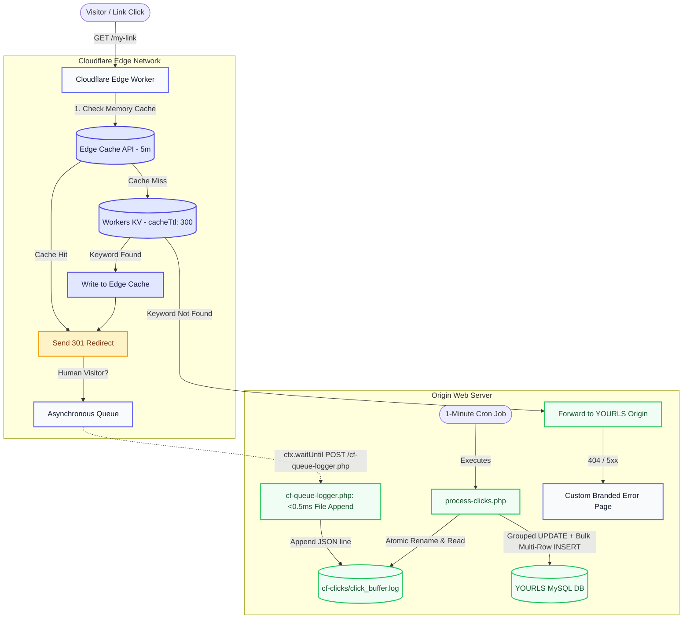

<div align="center">

# Edge Redirects for YOURLS
### Cloudflare Workers and Workers KV Integration (v2.0)

[](https://workers.cloudflare.com/)
[](https://developers.cloudflare.com/kv/)
[](https://yourls.org/)
[](LICENSE)

<p align="center">
  Sub-millisecond edge redirects • Asynchronous file-buffered queue • Two-tier edge caching • Zero database lock contention
</p>

---

</div>

> **Personal Project Note:** This project was originally designed for a personal YOURLS setup to eliminate origin server and database overhead, accelerate global redirect speeds to single-digit milliseconds, and maintain accurate click analytics.
>
> **Notice on Customizations & Contributions:** This repository is maintained specifically for personal production requirements and does not accept pull requests or feature requests. If you would like to make modifications, customize error templates, or adapt the code for your own setup, **please fork the repository and make any changes in your own fork**. Feel free to adapt and build upon it under the [MIT License](LICENSE)!

---

## Table of Contents

- [What's New in v2.0](#whats-new-in-v20)
- [Performance Comparison](#performance-comparison)
- [System Architecture](#system-architecture)
- [Key Features](#key-features)
- [Repository Structure](#repository-structure)
- [Quickstart Installation](#quickstart-installation)
  - [Step 1: Cloudflare KV Namespace and API Token](#step-1-cloudflare-kv-namespace-and-api-token)
  - [Step 2: Install YOURLS Plugin and Logging Bridge](#step-2-install-yourls-plugin-and-logging-bridge)
  - [Step 3: Configure Cron Job (Queue System)](#step-3-configure-cron-job-queue-system)
  - [Step 4: Configure and Deploy the Worker](#step-4-configure-and-deploy-the-worker)
- [Customization and Configuration](#customization-and-configuration)
  - [1. Origin Domain Configuration](#1-origin-domain-configuration-origin_domain)
  - [2. Reserved Origin Paths](#2-reserved-origin-paths-reserved_paths)
  - [3. Bot Categories Denylist](#3-bot-categories-denylist-bot_category_denylist)
  - [4. Custom Logging Endpoint](#4-custom-logging-endpoint-logging_endpoint)
  - [5. Bypassing Specific Folders via Cloudflare Dashboard](#5-bypassing-specific-folders-via-cloudflare-dashboard-zero-invocation-bypass)
- [Request Lifecycle and Routing Logic](#request-lifecycle-and-routing-logic)
- [Security Standards](#security-standards)
- [Frequently Asked Questions](#frequently-asked-questions)
- [References and Documentation](#references-and-documentation)
- [Contributions and Forking](#contributions-and-forking)
- [License](#license)

---

## What's New in v2.0

- **Fast V8 String Slicing**: Replaced `new URL(request.url)` on the main request path with zero-allocation string offset slicing (`indexOf` / `slice`), cutting isolate CPU overhead.
- **Native String Cache API Keys**: Replaced `new Request()` allocations with direct string keys in `caches.default.match()` and `put()`.
- **Double-Layer KV Datacenter Caching**: Added `{ cacheTtl: 300 }` to `env.YOURLS_LINKS.get()` to cache KV lookups directly in the local Cloudflare data center for 5 minutes during Tier 1 Cache API misses.
- **Instant Root HEAD Fast-Path**: Added instant 0.01ms HTTP 200 responses for `HEAD /` monitoring pings, eliminating cold-start CPU spikes from uptime monitors (e.g. UptimeRobot, Pingdom).
- **Asynchronous File-Buffered Queue (`cf-queue-logger.php`)**: Replaced direct MySQL connection writes with lock-free atomic file append (`cf-clicks/click_buffer.log`), slashing origin execution wall time from ~150 ms down to **< 0.5 ms**.
- **1-Minute Scheduled Batch Processor (`process-clicks.php`)**: Rotates the buffer atomically, aggregates click counts in memory (1 UPDATE query per keyword), and performs bulk multi-row inserts into `yourls_log` (500 rows per batch), eliminating database lock contention during traffic surges.
- **Clean Self-Contained Error Templates**: Redesigned 404 and 5xx error pages to be completely self-contained with modern, responsive light/dark mode CSS and SVG icons (zero external trackers or third-party assets).
- **Production Minified Worker (`worker.min.js`)**: Included a single-line minified build (~4.5 KB) for direct copy-paste deployment via Cloudflare Dashboard console.

---

## Performance Comparison

| Metric | Traditional YOURLS | Direct Edge Logging (v1) | File-Buffered Queue (v2.0) |
|---|---|---|---|
| **Redirect Latency** | `150ms – 600ms+` | `5ms – 25ms` | **`5ms – 25ms`** (nearest edge PoP) |
| **Origin Logging Wall Time** | 150ms – 400ms (blocking) | ~150ms (async via `waitUntil`) | **< 0.5ms** (non-blocking file buffer) |
| **Database Connections per Click** | 1 connection per click | 1 connection per click | **0 connections** (handled by 1-min cron) |
| **Database Lock Contention** | High during traffic surges | High during traffic surges | **Zero** (grouped updates + bulk multi-row inserts) |
| **KV Read Operations** | N/A | Reduced via Edge Cache | **Minimized** (Edge Cache API + KV datacenter cache) |
| **Uptime Monitor Cold Starts** | Wakes full PHP/MySQL | Wakes Worker & KV | **0.01ms instant 200 OK** on `HEAD /` |
| **Brute-Force & Bot Scanners** | Directly hits MySQL | 5-min negative cache | **Stopped at Edge** (5-min negative cache) |

---

## System Architecture



---

## Key Features

- **Sub-Millisecond Global Edge Redirects:** Cloudflare evaluates short keywords at the closest data center among 300+ PoPs worldwide and returns `301 Moved Permanently` redirects instantly.
- **Two-Tier Multi-Layer Caching:** Utilizes Cloudflare's [Cache API](https://developers.cloudflare.com/workers/runtime-apis/cache/) (`caches.default`) in front of [Workers KV](https://developers.cloudflare.com/kv/get-started/) with `{ cacheTtl: 300 }` edge data center caching.
- **Negative Caching (404 Flood Protection):** Non-existent keywords and scanner requests are cached as `404` at the edge for 5 minutes, preventing automated scrapers from overwhelming KV quotas.
- **Lock-Free Origin File Buffer:** The Worker dispatches background clicks to `cf-queue-logger.php`, which performs an atomic file append into `cf-clicks/click_buffer.log` in **< 0.5 ms** with zero database connections opened.
- **Batch Processing Cron Engine:** `process-clicks.php` runs every minute, rotates the log file atomically, aggregates duplicate keyword clicks in memory, and performs bulk multi-row inserts (500 rows per batch) into MySQL.
- **UTM Campaign and Query Passthrough:** Appends incoming URL parameters (e.g. `?utm_medium=social&ref=newsletter`) to the destination URL automatically while removing Cloudflare Turnstile/Challenge parameters.
- **Built-in Bot Management Filtering:** Ignores uptime monitors, crawler bots, and security scanners using [Cloudflare Bot Management categories](https://developers.cloudflare.com/bots/concepts/bot/) so analytics reflect real human engagements.
- **Social Media Preview Handler:** Returns `200 OK` to preview scrapers (WhatsApp, Telegram, Discord, Facebook, Twitter, LinkedIn) to ensure rich link preview snippets and OpenGraph meta tags parse properly.
- **Full Lifecycle Sync (Plugin v1.2):**
  - **Create Link:** Immediately writes shortcode and long URL to KV.
  - **Edit Link / Rename Keyword:** Updates destination URL and deletes previous keyword from KV automatically.
  - **Delete Link:** Purges the short code from KV instantly.
- **Authenticated Background Logging:** Protected by a shared secret (`X-Auth-Key`), constant-time hash comparisons (`hash_equals`), and a loopback prevention token (`X-From-Logger`).

---

## Repository Structure

```
yourls-cloudflare-kv-sync/
├── cloudflare-kv-sync/
│   └── plugin.php             # YOURLS plugin (v1.2) to sync CRUD actions to KV
├── worker/
│   ├── src/
│   │   ├── index.js           # Master readable Cloudflare Worker source code
│   │   └── worker.min.js      # Production minified single-line build (~4.5 KB)
│   ├── package.json           # Worker package definition & wrangler scripts
│   ├── wrangler.toml          # Wrangler configuration template & KV bindings
│   └── .dev.vars.example      # Local development environment variable template
├── cf-queue-logger.php        # Fast zero-database file buffer logger (Queue Endpoint)
├── process-clicks.php         # 1-minute cron batch processor (Bulk MySQL Inserts)
├── cf-click-logger.php        # Synchronous direct database logger (Fallback Endpoint)
├── cf-clicks/
│   └── .htaccess              # Apache directive blocking public web access to log files
├── config-snippet.php         # Configuration constants for user/config.php
├── ARCHITECTURE.md            # Deep technical architecture & V8 performance guide
├── CHANGELOG.md               # Version history and release notes
├── LICENSE                    # MIT License
└── README.md                  # Complete documentation & deployment guide
```

---

## Quickstart Installation

### Prerequisites
- Active [YOURLS](https://yourls.org/) instance (v1.7+) with PHP `curl` extension enabled.
- Cloudflare-managed domain with proxy (orange cloud) active.
- Local [Node.js](https://nodejs.org/) (v18+) and `npm` installed (if deploying via Wrangler).

---

### Step 1: Cloudflare KV Namespace and API Token

1. Go to **Cloudflare Dashboard** → **Workers & Pages** → **KV** (see [Workers KV Documentation](https://developers.cloudflare.com/kv/get-started/)).
2. Click **Create a Namespace** and name it (e.g., `YOURLS_LINKS`).
3. Note your **Namespace ID** and **Account ID**.
4. Navigate to **My Profile** → **API Tokens** → **Create Token** (see [Cloudflare API Token Guide](https://developers.cloudflare.com/fundamentals/api/get-started/create-token/)):
   - Template: **Create Custom Token**
   - Permissions: `Account` → `Workers KV Storage` → `Edit`
   - Account Resources: Select your Cloudflare Account
5. Copy and save your **API Token**.

---

### Step 2: Install YOURLS Plugin and Logging Bridge

1. Copy the [`cloudflare-kv-sync/`](file:///c:/Users/abdul/Desktop/Dev/yourls-cloudflare-kv-sync/cloudflare-kv-sync/plugin.php) folder to your server's `user/plugins/` directory:
   ```text
   yourls-root/
   └── user/
       └── plugins/
           └── cloudflare-kv-sync/
               └── plugin.php
   ```
2. Copy the queue logging scripts into your **YOURLS root directory** (alongside `yourls-loader.php` and `yourls-api.php`):
   - `cf-queue-logger.php` (file-buffered queue logger)
   - `process-clicks.php` (batch cron processor)
   - `cf-clicks/.htaccess` (inside a `cf-clicks` folder in YOURLS root)
3. Add the configuration block from [`config-snippet.php`](file:///c:/Users/abdul/Desktop/Dev/yourls-cloudflare-kv-sync/config-snippet.php) to your `user/config.php`:
   ```php
   /** Cloudflare KV Sync Credentials */
   define( 'CF_ACCOUNT_ID', 'your_cloudflare_account_id' );
   define( 'CF_KV_NAMESPACE_ID', 'your_kv_namespace_id' );
   define( 'CF_API_TOKEN', 'your_cloudflare_api_token' );

   /** Shared secret for background click logging */
   define( 'LOGGING_SECRET_KEY', 'generate_a_secure_random_string_here' );
   ```
4. Open the YOURLS Admin Panel (`/admin`), go to **Manage Plugins**, and click **Activate** on **Cloudflare KV Sync for YOURLS**.

---

### Step 3: Configure Cron Job (Queue System)

To process buffered clicks from `cf-clicks/click_buffer.log` into MySQL, set up a cron job to run once every minute:

#### In cPanel:
1. Go to **cPanel** → **Cron Jobs**.
2. Select frequency: **Once Per Minute (`* * * * *`)**.
3. Command:
   ```bash
   /usr/local/bin/php /home/USERNAME/public_html/process-clicks.php >/dev/null 2>&1
   ```
   *(Replace `/home/USERNAME/public_html/` with your actual server path).*

#### Web-Based Cron Alternative:
If you do not have CLI cron access, trigger `process-clicks.php` via an external cron service (e.g. Cron-Job.org) using your secret key:
```
https://yourdomain.com/process-clicks.php?secret=YOUR_LOGGING_SECRET_KEY
```

---

### Step 4: Configure and Deploy the Worker

#### Option A: Deploy with Wrangler CLI
1. Open a terminal in the `worker/` directory and install dependencies:
   ```bash
   cd worker
   npm install
   ```
2. Edit [`worker/wrangler.toml`](file:///c:/Users/abdul/Desktop/Dev/yourls-cloudflare-kv-sync/worker/wrangler.toml) with your KV Namespace ID:
   ```toml
   name = "yourls-kv-redirect"
   main = "src/index.js"
   compatibility_date = "2024-11-01"

   [[kv_namespaces]]
   binding = "YOURLS_LINKS"
   id = "your_kv_namespace_id_here"
   ```
3. Set the shared secret in Cloudflare (must match `LOGGING_SECRET_KEY` in `user/config.php`; see [Workers Secrets Documentation](https://developers.cloudflare.com/workers/configuration/secrets/)):
   ```bash
   npx wrangler secret put LOGGING_SECRET_KEY
   ```
4. Deploy the Worker to Cloudflare:
   ```bash
   npm run deploy
   ```
5. Map the Worker to your domain (see [Cloudflare Workers Routes](https://developers.cloudflare.com/workers/configuration/routing/routes/)):
   - In Cloudflare Dashboard, go to your **Domain (Zone)** → **Workers Routes** → **Add Route**.
   - Set **Route** to `yourdomain.com/*` (or `short.domain.com/*`) and select the deployed Worker.

#### Option B: Manual Dashboard Console Paste
1. Open [`worker/src/worker.min.js`](file:///c:/Users/abdul/Desktop/Dev/yourls-cloudflare-kv-sync/worker/src/worker.min.js).
2. Copy the entire single line of code.
3. In Cloudflare Dashboard, navigate to **Workers & Pages** → Create or select your Worker → **Quick Edit**.
4. Paste the code into the editor.
5. In **Settings** → **Variables and Secrets**:
   - Add Secret: `LOGGING_SECRET_KEY` = your secret string.
   - Add KV Namespace Binding: Variable Name `YOURLS_LINKS` mapped to your KV namespace.
6. Click **Deploy**.

---

## Customization and Configuration

You can customize runtime behavior directly in [`worker/src/index.js`](file:///c:/Users/abdul/Desktop/Dev/yourls-cloudflare-kv-sync/worker/src/index.js) or via environment variables in [`worker/wrangler.toml`](file:///c:/Users/abdul/Desktop/Dev/yourls-cloudflare-kv-sync/worker/wrangler.toml):

### 1. Origin Domain Configuration (`ORIGIN_DOMAIN`)
By default, the Worker **automatically detects** your domain from incoming requests (`request.url`), so it works out of the box with zero configuration!

If you want to explicitly pin a primary apex domain (e.g., if you route both `www.yourdomain.com` and `yourdomain.com` to the Worker, ensuring all cache keys and logging requests consolidate to one primary host):
- Set `DEFAULT_ORIGIN_DOMAIN = "yourdomain.com";` in `worker/src/index.js`, or
- Configure `ORIGIN_DOMAIN` in `worker/wrangler.toml`:
```toml
# In worker/wrangler.toml
[vars]
ORIGIN_DOMAIN = "yourdomain.com"
```

### 2. Reserved Origin Paths (`RESERVED_PATHS`)
Define paths that should never be treated as short links and must always pass directly to your origin web server (e.g. landing pages, blog, portal):
```toml
# In worker/wrangler.toml
[vars]
RESERVED_PATHS = "about,contact,pricing,terms,privacy,blog,docs"
```

### 3. Bot Categories Denylist (`BOT_CATEGORY_DENYLIST`)
Specify Cloudflare Bot Management categories that should **not** trigger click logging on your server (see [Bot Management Category Concepts](https://developers.cloudflare.com/bots/concepts/bot/)):
```toml
# In worker/wrangler.toml
[vars]
BOT_CATEGORY_DENYLIST = "Monitoring & Analytics,Security Scanner,Advertising,Security,Advertising & Marketing"
```

### 4. Custom Logging Endpoint (`LOGGING_ENDPOINT`)
The worker defaults to `/cf-queue-logger.php` (Queue System). If you prefer synchronous direct database logging, set:
```toml
# In worker/wrangler.toml
[vars]
LOGGING_ENDPOINT = "/cf-click-logger.php"
```

### 5. Bypassing Specific Folders via Cloudflare Dashboard (Zero-Invocation Bypass)
If you have entire subdirectories or apps on the same domain (e.g., `/blog/*`, `/app/*`, `/shop/*`, `/wp-admin/*`) that you want to bypass the Worker completely at Cloudflare's network layer:
1. In Cloudflare Dashboard, open your **Domain**.
2. Go to **Workers Routes** → **Add Route**.
3. Set the pattern to bypass (e.g. `yourdomain.com/blog/*` or `yourdomain.com/portal/*`).
4. Set **Worker** to **`None`** (Cloudflare displays: *"Workers are disabled on this route"*).
5. Cloudflare will serve requests matching this pattern directly from your origin without invoking the Worker.

> For more details on route precedence and pattern matching, review the official [Cloudflare Workers Routes Documentation](https://developers.cloudflare.com/workers/configuration/routing/routes/).

---

## Request Lifecycle and Routing Logic

```
Incoming Request: https://yourdomain.com/{path}
  │
  ├──► Is loopback request? (X-From-Logger: 1) ──► Proxy to Origin
  │
  ├──► Matches Static Asset / Admin / API / Logger? ──► Proxy to Origin
  │       └── If HEAD / (Uptime Monitor) ──► Return Instant 200 OK (0.01ms)
  │
  ├──► Ends with '+' (Stats Request)? ──► Proxy to Origin
  │
  ├──► Matches Reserved Path or Invalid Keyword? ──► Proxy to Origin
  │
  └──► Valid Short Keyword Lookup:
        ├── 1. Check Cloudflare Edge Cache API (5 min)
        │     ├── Hit (URL) ──► 301 Redirect + Async Log (cf-queue-logger.php)
        │     └── Hit (404) ──► Proxy to Origin (404 cached)
        │
        └── 2. Check Cloudflare KV Database (cacheTtl: 300)
              ├── Found ──► Store in Edge Cache (5 min) ──► 301 Redirect + Async Log
              └── Not Found ──► Store 404 in Edge Cache (5 min) ──► Proxy to Origin
```

---

## Security Standards

- **Zero Secret Exposure:** Never commit `LOGGING_SECRET_KEY`, `CF_API_TOKEN`, or `user/config.php` to version control.
- **Strict Header Validation:** `cf-queue-logger.php` and `cf-click-logger.php` reject unauthorized requests with `401 Unauthorized` using `hash_equals()` to prevent microsecond side-channel timing attacks.
- **Subrequest Loopback Prevention:** The worker appends `X-From-Logger: 1` to prevent logging requests from triggering edge worker recursion.
- **Input Sanitization:** All payload values (IP, referrer, user agent, country code) are sanitized and truncated prior to MySQL database insertion.
- **Directory Privacy Shield:** `cf-clicks/.htaccess` blocks public web access to raw log files.
- **Emergency Kill Switch:** Set `const ENABLE_LOG_CLICK = false;` at the top of the logging script to drop all incoming logs instantly with 0.05ms execution time.
- **HTTPS Enforced:** All edge redirects and origin communications operate exclusively over encrypted TLS connections.

---

## Frequently Asked Questions

<details>
<summary><b>Why use the Queue System (cf-queue-logger.php) instead of direct logging?</b></summary>
<br>
Direct logging opens a PHP process and a MySQL connection on every click. During viral traffic spikes, hundreds of concurrent database connections can lock tables and exhaust server memory. The Queue System simply appends a ~220-byte JSON line to a file in < 0.5 ms without touching MySQL, and the 1-minute cron processor commits all clicks in bulk with grouped queries.
</details>

<details>
<summary><b>Do existing links sync automatically?</b></summary>
<br>
The plugin automatically syncs newly created, edited, and deleted links. If you have older links created before installing this plugin, simply re-save them in the YOURLS Admin, or perform a one-time bulk import into Cloudflare KV using the Cloudflare API or CLI.
</details>

<details>
<summary><b>How does negative 404 caching protect my KV read quotas?</b></summary>
<br>
When automated bots probe random non-existent URLs, the first request is looked up in KV. Once confirmed non-existent, the 404 status is cached in Cloudflare Edge Cache for 5 minutes. Any subsequent requests for that missing keyword within 5 minutes are answered instantly from cache without touching your KV read quota.
</details>

<details>
<summary><b>Will link tracking break if my origin server is down?</b></summary>
<br>
No. Because links are stored in KV and Edge Cache, 301 redirects continue to function globally with zero downtime. The background logger uses non-blocking <code>ctx.waitUntil</code> with an abort timeout, so any temporary origin failure will never impact the visitor's redirection experience.
</details>

---

## References and Documentation

- [Cloudflare Workers Documentation](https://developers.cloudflare.com/workers/)
- [Cloudflare Workers KV Getting Started](https://developers.cloudflare.com/kv/get-started/)
- [Cloudflare Workers Cache API](https://developers.cloudflare.com/workers/runtime-apis/cache/)
- [Cloudflare Workers Routes and Routing Precedence](https://developers.cloudflare.com/workers/configuration/routing/routes/)
- [Cloudflare Workers Secrets Configuration](https://developers.cloudflare.com/workers/configuration/secrets/)
- [Cloudflare Bot Management Concepts and Verified Categories](https://developers.cloudflare.com/bots/concepts/bot/)
- [Cloudflare API Tokens Guide](https://developers.cloudflare.com/fundamentals/api/get-started/create-token/)
- [YOURLS Official Documentation](https://yourls.org/)

---

## Contributions and Forking

This project is maintained for personal use and production requirements. **Pull requests and feature requests are not accepted.**

If you need different behavior, alternative templates, or additional features, **please fork the repository and make the changes in your own fork**. You are completely free to modify, customize, and distribute your own version under the terms of the [MIT License](LICENSE).

---

## License

Distributed under the **MIT License**. See [`LICENSE`](file:///c:/Users/abdul/Desktop/Dev/yourls-cloudflare-kv-sync/LICENSE) for full details.
